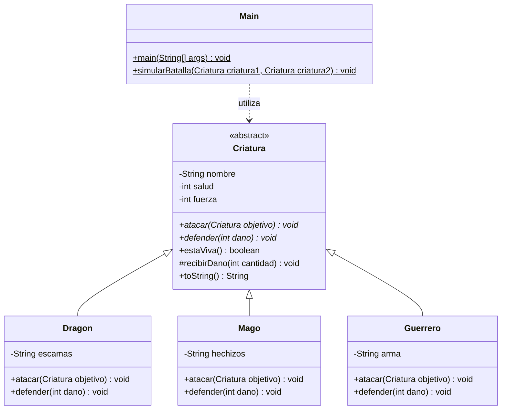

# parcial2
Parcial 2 de Programación ll, Sistema de batallas.

## Integrantes

- Alejandro Mosquera Corrales
- Angel Esteban Cuenu Chachinoy

## Sobre el proyecto

Este proyecto de Programación II está hecho en Java con Maven. Simula batallas entre un dragón, un mago y un guerrero, mostrando los ataques, la salud y el ganador en la consola.

## Cómo está organizado el código

`Criatura` es la clase abstracta que reúne el nombre, la salud y la fuerza. `Dragon`, `Mago` y `Guerrero` heredan de ella y cada una implementa sus métodos de ataque y defensa.

En `Main` se crean las criaturas y se ejecutan las batallas. El método `simularBatalla` recibe objetos de tipo `Criatura`, por lo que puede trabajar con cualquiera de las tres clases. Así se aplica el polimorfismo.

Para ejecutar el programa, se abre el proyecto en VS Code y se pulsa **Run** sobre el método `main` de `Main.java`.

## Diagrama UML

